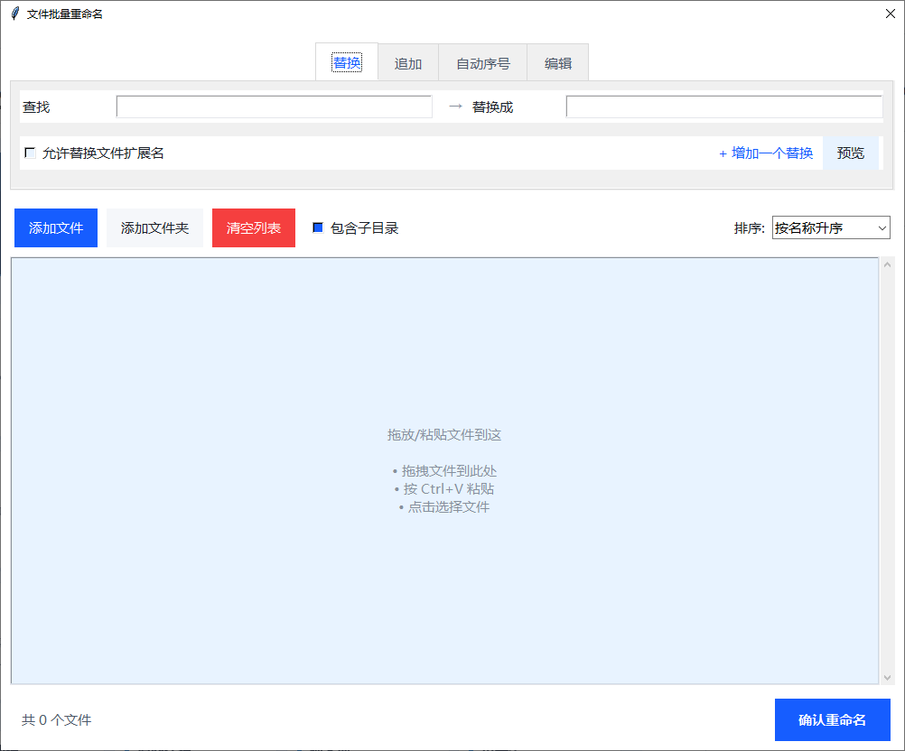

# 图片处理工具 专业版

一款 Windows 桌面端的本地图片批处理工具。**绿色单文件、免安装、无需联网、双击即用**。

## 功能

| 功能 | 说明 |
| --- | --- |
| 格式转换 | PNG / BMP / GIF 等格式一键批量转 JPG |
| 批量压缩 | 压缩质量 1–100 可调，更省空间 |
| 批量重命名 | 替换、追加、自动序号、编辑 |
| 无效 JPG 清理 | 扫描损坏文件，选中后一键删除 |

- 整个文件夹一次搞定，支持拖拽导入，进度实时可见
- 原图保护：可保留原始图片、保持原路径
- 纯本地运行，图片不上传、不联网
- 无水印、无广告、无卡密

## 界面预览

**文件批量重命名** — 支持「替换 / 追加 / 自动序号 / 编辑」四种模式，可拖拽或 Ctrl+V 粘贴文件，按名称或时间排序后一键确认重命名。

## 下载

前往 **[Releases 下载页](https://github.com/xg0001/image-tool-pro/releases/latest)** 下载 `ImageToolPro-v1.0.exe`，双击运行即可（下载后如需中文文件名，可自行重命名）。

- 适用系统：Windows 10 / 11 64 位
- 无需安装 Python 或任何依赖
- 首次运行若被 SmartScreen 拦截，选择「更多信息 → 仍要运行」（单文件程序未做数字签名）

## 说明

本仓库仅提供成品程序与说明文档，**不包含源代码**。
